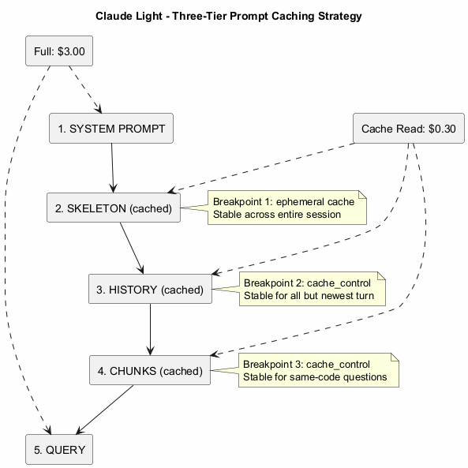
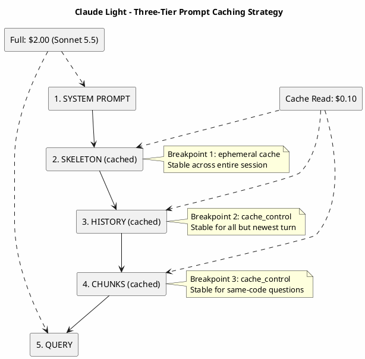

# Three-Tier Caching Strategy

> Part of the [architecture index](ARCHITECTURE.md). Source: the original `docs/architecture.md`, split by topic.

Prompt caching is a Claude capability. Gemini and Codex have none: they get the same skeleton and chunks as text on standard input, `warm_cache()` does nothing for them, and the turn stats say `tokens, cost and caching unavailable for <provider>`. The rest of this page is about Claude.

Claude Light uses Anthropic's ephemeral caching with three strategic breakpoints to minimize costs.

### Cache Breakpoints

| Breakpoint | Location | Stable Across | Savings |
|------------|----------|---------------|---------|
| 1 | End of skeleton | Entire session | 90% off skeleton re-reads |
| 2 | End of history | All but newest turn | 90% off conversation history |
| 3 | End of chunks | Consecutive same-topic queries | 90% off retrieved context |

### Effort and model changes

- **Effort.** A top-level `output_config.effort` change invalidates the history cache, and on some models the skeleton cache too. Requests therefore always send `BASE_EFFORT` at the top level, and the routed effort goes in an effort-only system message after the history breakpoint (`_apply_effort()`, see [routing.md](routing.md)). `warm_cache()` (it calls `ClaudeProvider.warm()` in `providers/claude.py`) sends the same top-level effort, or it would warm an entry no turn reads.
- **Model.** The cache is scoped per model; nothing written on Sonnet is read by Haiku or Opus. `warm_cache()` warms `MODEL` (Sonnet) only, so the first Haiku or Opus turn writes that model's skeleton entry, once per hour. By default the first turn's model is kept for the session (`ROUTE_ONCE`), so a session writes one model's cache only; after that turn, `warm_cache()` warms the session model rather than `MODEL`. `CLAUDE_LIGHT_ROUTE_ONCE=0` routes the model per turn. Keeping a session on its strongest model instead cost more in `tests/benchmarks/benchmark_session_cache.py` than the cache writes it saves.

### Pricing (USD per 1M tokens)

Every call is priced at the model that ran it (`MODEL_PRICES` in `config.py`, list prices checked 2026-10-24). The skeleton block uses the 1-hour cache TTL, so its writes cost the 1 h rate; in OAuth mode the cost the Claude CLI reports for the turn is used as is.

| Model | Input | Cache write (5 m) | Cache write (1 h) | Cache read | Output |
|-------|-------|-------------------|-------------------|------------|--------|
| Haiku 5.5 | $0.10 | $0.125 | $0.20 | $0.01 | $0.50 |
| Sonnet 5.5 | $2.00 | $2.50 | $4.00 | $0.10 | $10.00 |
| Opus 5.5 | $4.00 | $5.00 | $8.00 | $0.20 | $20.00 |
| Fable 5.1 | $10.00 | $12.50 | $20.00 | $0.25 | $50.00 |

View PlantUML Source

---

