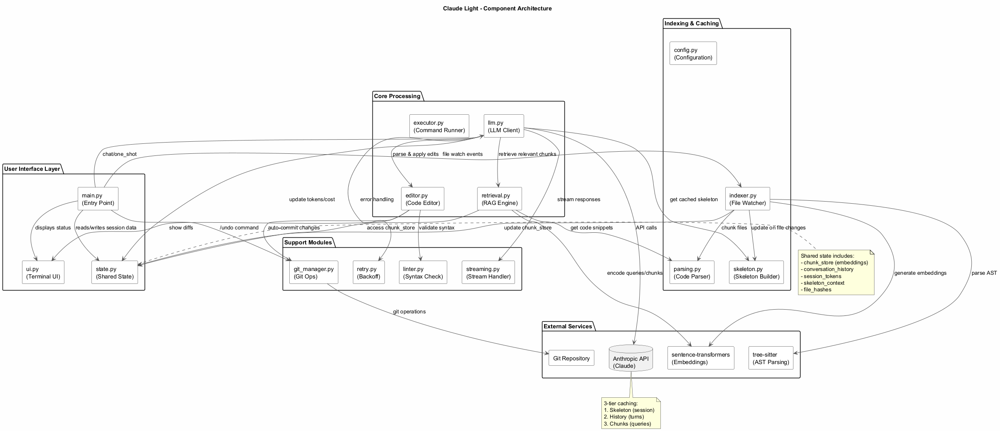
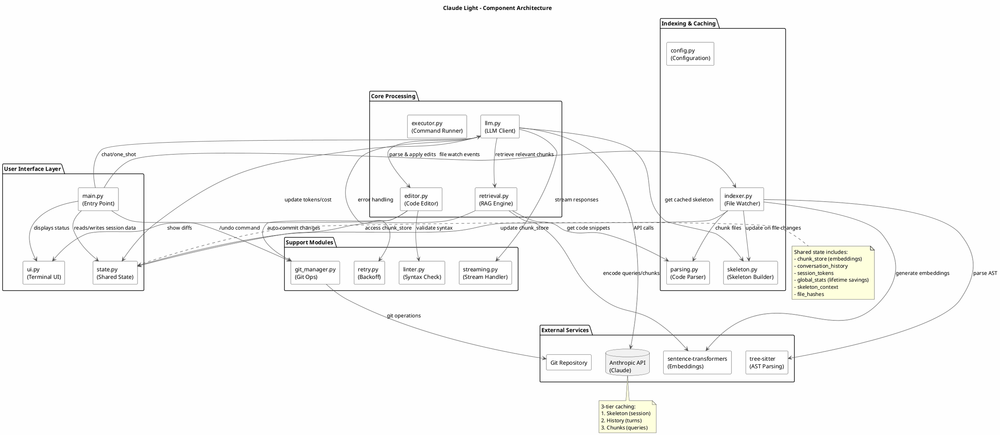

# Component Architecture

> Part of the [architecture index](ARCHITECTURE.md). Source: the original `docs/architecture.md`, split by topic.

This diagram shows the main components and their relationships within Claude Light.

### Key Components

| Component | Responsibility |
|-----------|----------------|
| `main.py` | Entry point, orchestrates the chat loop and handles user commands |
| `llm.py` | Turn loop, routing and response processing. It reaches an agent only through `providers.active()` |
| `providers/` | One module per agent behind the shared `Provider` interface (`base.py`): `claude.py` (the `anthropic` client, the API-key and OAuth transports, the tool loop, login), `gemini.py` and `codex.py` (CLI subprocesses), `runner.py` (`run_cli`, `kill_process_tree`, `TIMEOUT_SECS`) and `__init__.py` (`NAMES`, `DEFAULT`, `get`, `select`, `active`) |
| `retrieval.py` | RAG engine, performs similarity search and chunk selection |
| `callgraph.py` | In-memory call graph over the chunk store (`name(` matched against chunk symbols), used by `fetch_chunk` and the opt-in retrieval expansion |
| `tools.py` | API-mode tools: `read_file`, `fetch_chunk`, `grep`, `list_files`, and `shell` (allowlisted commands only) |
| `cli_shell_guard.py` | `PreToolUse` hook for the OAuth CLI agent: blocks a Bash or PowerShell command that chains, pipes, redirects or substitutes (issue #70); holds the refused characters `tools.py` uses too |
| `affected_tests.py` | After an auto-commit, runs the test files that mention the edited modules, if a pytest command is allowed |
| `editor.py` | Code editor, parses and applies SEARCH/REPLACE blocks |
| `indexer.py` | File watcher, manages incremental indexing and cache |
| `skeleton.py` | Builds compressed directory tree and markdown documentation |
| `state.py` | Shared state module for thread-safe access to session data |
| `session.py` | Saves the conversation, turn count and session model after each interactive turn; `--continue` restores them into `state` (the history list in place, since `_wrap()` re-binds it) |
| `config.py` | Configuration constants and dual-mode authentication resolution |

### Authentication Modes

`claude_light` supports two distinct authentication paths:

*   **API Key Mode**: Standard developer access. Authenticates via the `x-api-key` header. Billing is usage-based (USD).
*   **OAuth/Pro Mode**: Accesses your Claude Pro subscription via the official CLI session. Authenticates via the `Authorization: Bearer` header. Billing is flat-rate (Tokens shown, USD hidden).

### Providers

`--provider {claude,gemini,codex}` picks the agent; the default is `claude`, with the authentication order above. Each provider checks its own login in `require_auth()`: `gemini` needs the Antigravity CLI `agy` on PATH (`agy not found. Install the Antigravity CLI: https://antigravity.google`; no credential file, so a missing sign-in surfaces as a `ProviderError` on the first question, naming `result.error`); `codex` needs the `codex` CLI plus `$CODEX_HOME/auth.json` (default `~/.codex/auth.json`, from `codex login`). Claude's capabilities are caching, effort, top tier, USD budget, usage, agent and shell. Gemini and Codex have none, so the route line shows `effort unavailable for <provider>` (and `top tier unavailable` on a top-tier route), `/budget` answers `Budget unavailable for <provider>`, turn stats, `/cost`, the exit footer and the status bar say `tokens, cost and caching unavailable for <provider>`, and `--allow-command` prints that shell access is disabled (the agent cannot run commands). Neutral code never names a provider or its binary (`tests/unit/test_provider_isolation.py`).

Gemini runs `agy` in plan mode with a per-run `--settings` that denies command, mcp and file (agy otherwise runs the user's globally allowed MCP shell), reading and writing NDJSON events (`--input-format/--output-format stream-json`) and taking the `result` event's `response`. Every message starts with a no-tools preamble (`gemini._PREAMBLE`): without it real agy called `run_command` in 3 of 3 edit runs, was denied, and returned an empty response; with it 3 of 3 returned SEARCH/REPLACE blocks. A SUCCESS result with an empty response and a non-empty `denied_actions` raises a `ProviderError` naming the denied action. The run fails closed by allowlist: a finished (`DONE`) `step_update` passes only if its tool is read-only (`search_web`, `read_file`, `view_file`, `list_dir`, `find_by_name`, `grep_search`), or it is a command (`run_command`, `send_command_input`), mcp (`call_mcp_tool`) or file (`write_to_file`, `replace_file_content`, `multi_replace_file_content`, `sed_file`, `notebook_edit`) tool and the count of finished steps of that kind does not exceed the count of `denied_actions` records of that kind. Any other tool raises `agy ran <tool>, which claude_light forbids`. Known limit: `search_web` still runs. Codex runs with read-only flags. Both run in an empty temporary working directory (`runner.empty_temp_dir()`), removed after the run. The repo is not their working directory because a CLI started in the project loads that project's configuration: a real `gemini` CLI run there executed a repo's `.gemini/settings.json` hooks and `tools.discoveryCommand`. Their answers come only from the transcript on standard input (skeleton and retrieved chunks). A failing run raises `ProviderError`, whose message names the provider, the exit code and the last error line of stderr (stack frames skipped), and a run is stopped after `TIMEOUT_SECS` (600). The conversation is saved per provider, so `--continue` does not mix histories.

### External Dependencies

- **Anthropic API** - Claude models (Haiku, Sonnet, Opus)
- **sentence-transformers** - Text embeddings for RAG
- **tree-sitter** - AST parsing for method-level chunking
- **Git** - Version control for auto-commit feature

View PlantUML Source

---

## Module wiring

Modules import each other's globals at load time, so `__init__.py` wraps every public function in a `_wrap()` decorator. The wrapper calls `_sync_bindings()` before and `_refresh_exports()` after each call, which keeps every module's references to shared state (`state.embedder`, `state.chunk_store`, ...) consistent without circular imports. Shared mutable state lives in `state.py` behind `threading.Lock`.

## Agent mode and allowed commands

In OAuth mode, `AGENT_SYSTEM_PROMPT` replaces `SYSTEM_PROMPT` when `ALLOWED_COMMANDS` is non-empty. The agent then edits with its own Edit/Write tools and runs the allowed commands to check its work. SEARCH/REPLACE blocks only land after the turn, which is too late to test.

`ALLOWED_COMMANDS` holds shell command prefixes, each becoming `Bash(<prefix>:*)`, or `PowerShell(<prefix>:*)` for a `powershell:` or `pwsh:` entry. They come from `--allow-command` or `CLAUDE_LIGHT_ALLOW_COMMANDS` (`;`-separated). The CLI runs with `--permission-mode acceptEdits`, `--setting-sources user` and `--strict-mcp-config`, so the target repo's `.claude/settings*.json` (allow rules, hooks) and `.mcp.json` never apply. A shell stays disallowed unless an entry names it: Bash for untagged or `bash:` entries, PowerShell for `powershell:` or `pwsh:`. The CLI matches an allow rule against a command's first statement only, so `echo a && touch b` ran under `Bash(echo:*)` (issue #70, claude 2.1.314). With an allowlist, the `--settings` file therefore also installs a `PreToolUse` hook for `Bash|PowerShell` that runs `cli_shell_guard.py` with `python -I` and blocks (exit 2) any command containing a character from the `shell` tool's refused set below, chosen by the hook's `tool_name`. The guard is stdlib-only and fails closed: input it cannot read also exits 2. Refused commands are listed after the turn.

In API mode the same prefixes gate the `shell` tool in `tools.py`. A command must start with an allowed prefix on a word boundary, and any of `; & | < > `` ` `` $` or a newline is refused before whitespace is collapsed. A PowerShell command also may not contain `( ) { } @`: PowerShell evaluates an argument written as `(New-Item x)` or `@(...)`, which runs a second command with none of the other characters. `cli_shell_guard.forbidden_chars(tool)` holds both sets, and any tool name other than `Bash` gets the PowerShell one. It runs from the project root with a 120 s timeout (`CLAUDE_LIGHT_RUN_TIMEOUT`); on timeout the whole process tree is killed (`taskkill /T` on Windows, the process group on POSIX). The tool is always in `TOOLS`, even with no allowlist, so the cached prompt prefix does not change between sessions.

## Test mode

`--test-mode small` generates 5 files with 10 methods each. `--test-mode extra-large` generates 1000 files with 20 methods each. Both need no API key. Helpers live in `testing.py`. The fakes themselves are `MockManager` in `tests/utilities/test_mocks.py`, which patches functions by name and so breaks silently when their signatures change (#100). `tests/integration/test_test_mode.py` runs `--test-mode small` end to end as a subprocess, so CI catches that drift.

## Reliability and lifecycle

- **Auto-retry** (`retry.py`): exponential backoff 2 s, 4 s, 8 s (capped at 60 s), max 3 attempts. Non-retriable errors (401/403/404/400) fail immediately. `retry.py` checks `sys.modules` instead of importing the SDK.
- **Thread-safe state** (`state.py`): all shared state is protected by `threading.Lock`. Global stats (`~/.claude_light_stats.json`, or `CLAUDE_LIGHT_STATS_FILE`) load on startup and save on every usage update. `state.turn_count` counts turns; do not derive it from `conversation_history`, which compression shrinks.
- **Streaming** (`streaming.py`, `ui.ResponseView`): both auth modes render through one `ResponseView` per turn. Finished markdown blocks print once; only the block still arriving is redrawn. Thinking changes the spinner label. OAuth history summaries go through the CLI (`render=False`), since that mode has no API key.
- **Startup**: the `anthropic` SDK is imported lazily (`providers/claude.py: _LazyClient`), so OAuth sessions never load it. The prompt appears in about 0.5 s instead of 2 s warm and 7 s cold.
- **Watchdog lifecycle** (`main.py`): the observer is stopped and joined on exit (5 s timeout). Ctrl+C cancels the current turn and kills the CLI agent's process tree (`kill_process_tree` in `providers/runner.py`; `taskkill /T` on Windows, where the CLI runs under `cmd.exe`), then returns to the prompt. At the prompt it exits. SIGTERM exits, and `start_chat()`'s `finally` sets `stop_event`.
