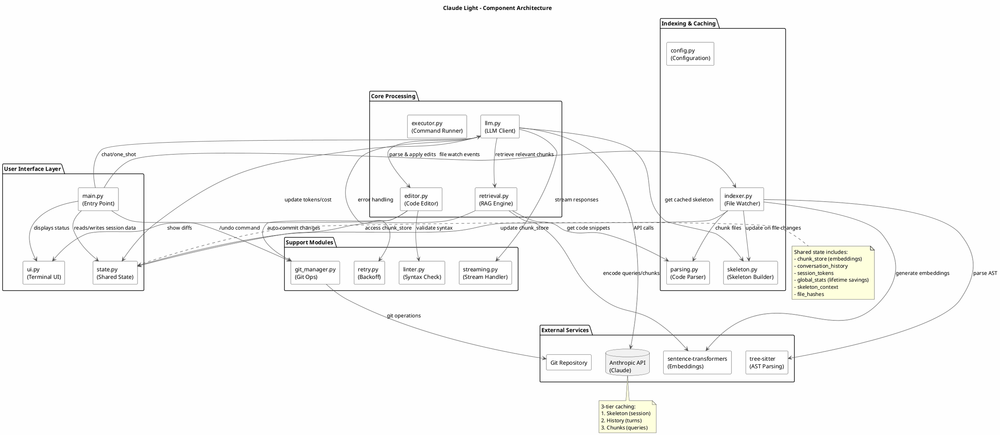

# Component Architecture

> Part of the [architecture index](ARCHITECTURE.md). Source: the original `docs/architecture.md`, split by topic.

This diagram shows the main components and their relationships within Claude Light.

### Key Components

| Component | Responsibility |
|-----------|----------------|
| `main.py` | Entry point, orchestrates the chat loop and handles user commands |
| `llm.py` | LLM client, handles API calls, routing, and response processing |
| `retrieval.py` | RAG engine, performs similarity search and chunk selection |
| `editor.py` | Code editor, parses and applies SEARCH/REPLACE blocks |
| `indexer.py` | File watcher, manages incremental indexing and cache |
| `skeleton.py` | Builds compressed directory tree and markdown documentation |
| `state.py` | Shared state module for thread-safe access to session data |
| `config.py` | Configuration constants and dual-mode authentication resolution |

### Authentication Modes

`claude_light` supports two distinct authentication paths:

*   **API Key Mode**: Standard developer access. Authenticates via the `x-api-key` header. Billing is usage-based (USD).
*   **OAuth/Pro Mode**: Accesses your Claude Pro subscription via the official CLI session. Authenticates via the `Authorization: Bearer` header. Billing is flat-rate (Tokens shown, USD hidden).

### External Dependencies

- **Anthropic API** - Claude models (Haiku, Sonnet, Opus)
- **sentence-transformers** - Text embeddings for RAG
- **tree-sitter** - AST parsing for method-level chunking
- **Git** - Version control for auto-commit feature

View PlantUML Source

---

## Module wiring

Modules import each other's globals at load time, so `__init__.py` wraps every public function in a `_wrap()` decorator. The wrapper calls `_sync_bindings()` before and `_refresh_exports()` after each call, which keeps every module's references to shared state (`state.embedder`, `state.chunk_store`, ...) consistent without circular imports. Shared mutable state lives in `state.py` behind `threading.Lock`.

## Agent mode and allowed commands

In OAuth mode, `AGENT_SYSTEM_PROMPT` replaces `SYSTEM_PROMPT` when `ALLOWED_COMMANDS` is non-empty. The agent then edits with its own Edit/Write tools and runs the allowed commands to check its work. SEARCH/REPLACE blocks only land after the turn, which is too late to test.

`ALLOWED_COMMANDS` holds shell command prefixes, each becoming `Bash(<prefix>:*)`, or `PowerShell(<prefix>:*)` for a `powershell:` or `pwsh:` entry. They come from `--allow-command` or `CLAUDE_LIGHT_ALLOW_COMMANDS` (`;`-separated). The CLI runs with `--permission-mode acceptEdits`, `--setting-sources user` and `--strict-mcp-config`, so the target repo's `.claude/settings*.json` (allow rules, hooks) and `.mcp.json` never apply. A shell stays disallowed unless an entry names it: Bash for untagged or `bash:` entries, PowerShell for `powershell:` or `pwsh:`. Refused commands are listed after the turn.

## Test mode

`--test-mode small` generates 5 files with 10 methods each. `--test-mode extra-large` generates 1000 files with 20 methods each. Both need no API key. Helpers live in `testing.py`.

## Reliability and lifecycle

- **Auto-retry** (`retry.py`): exponential backoff 2 s, 4 s, 8 s (capped at 60 s), max 3 attempts. Non-retriable errors (401/403/404/400) fail immediately. `retry.py` checks `sys.modules` instead of importing the SDK.
- **Thread-safe state** (`state.py`): all shared state is protected by `threading.Lock`. Global stats (`~/.claude_light_stats.json`, or `CLAUDE_LIGHT_STATS_FILE`) load on startup and save on every usage update. `state.turn_count` counts turns; do not derive it from `conversation_history`, which compression shrinks.
- **Streaming** (`streaming.py`, `ui.ResponseView`): both auth modes render through one `ResponseView` per turn. Finished markdown blocks print once; only the block still arriving is redrawn. Thinking changes the spinner label. OAuth history summaries go through the CLI (`render=False`), since that mode has no API key.
- **Startup**: the `anthropic` SDK is imported lazily (`llm._LazyClient`), so OAuth sessions never load it. The prompt appears in about 0.5 s instead of 2 s warm and 7 s cold.
- **Watchdog lifecycle** (`main.py`): the observer is stopped and joined on exit (5 s timeout). Ctrl+C cancels the current turn and kills the CLI agent's process tree (`_kill_process_tree` in `llm.py`; `taskkill /T` on Windows, where the CLI runs under `cmd.exe`), then returns to the prompt. At the prompt it exits. SIGTERM exits, and `start_chat()`'s `finally` sets `stop_event`.
