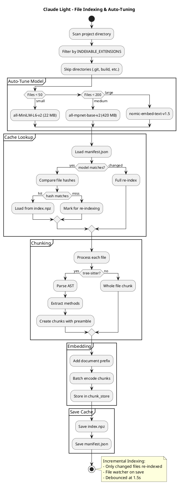

# File Indexing Flow

> Part of the [architecture index](ARCHITECTURE.md). Source: the original `docs/architecture.md`, split by topic.


The indexing system builds and maintains an incremental cache of code embeddings.


### Auto-Tuned Models

| Repo Size | Model | Size | Use Case |
|-----------|-------|------|----------|
| < 50 files | all-MiniLM-L6-v2 | 22 MB | Fast startup |
| 50-199 files | all-mpnet-base-v2 | 420 MB | Better depth |
| 200+ files | nomic-embed-text-v1.5 | 275 MB | Optimal recall |

### Method-Level Chunking

Instead of whole files, tree-sitter parses the AST and extracts individual methods:

```
chunk_id: filepath::methodName
text: // filepath
      package com.example;
      import java.util.*;
      
      public class Service {
          // ...
      }
      
      public ReturnType methodName(Args) {
          // method body
      }
```

**Benefits:**
- Self-contained: each chunk has full context
- Precise retrieval: fetch only relevant methods
- Deduplication: shared preamble emitted once
- Token efficiency: 5-10x reduction vs whole files

### Incremental Indexing

- Only changed files are re-chunked and re-embedded
- Cache is loaded on startup, avoiding redundant work
- File watcher triggers re-index on save
- Debounced at 1.5s to avoid rapid re-indexing

<details>
<summary>View PlantUML Source</summary>



</details>

---


## Disk cache

Embeddings persist to `.claude_light_cache/index.npz` between runs. Ids and texts are stored as JSON and vectors as float32 arrays. The file is loaded with `allow_pickle=False`: the directory may come from a cloned repo, and the old `index.pkl` ran whatever a repo shipped in it. An old `index.pkl` is deleted, never read. A `manifest.json` tracks per-file MD5 hashes and the embedding model used, so only changed or new files are re-embedded on restart. Command history (prompt_toolkit) is stored here too. The conversation is not: `session.py` saves it for `--continue` under `~/.claude_light_sessions/`, outside the project, so a cloned repo cannot supply one.
