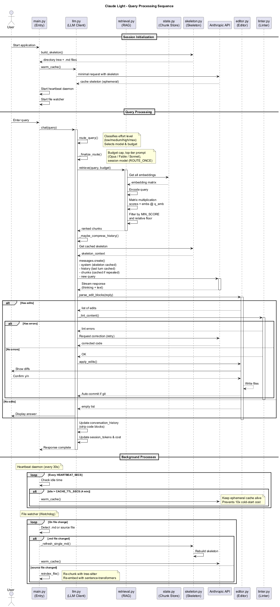
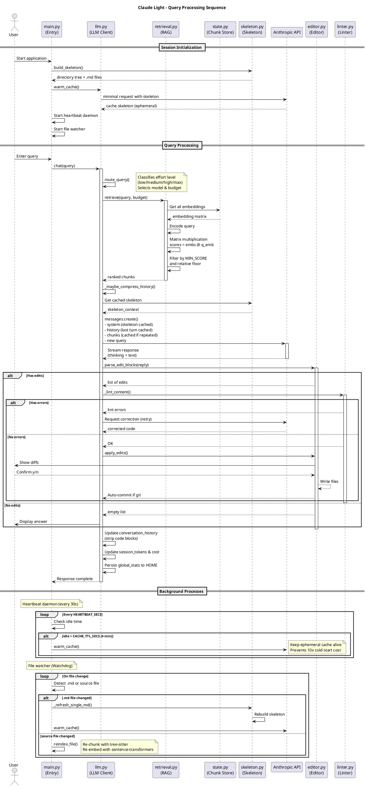

# Query Processing Sequence

> Part of the [architecture index](ARCHITECTURE.md). Source: the original `docs/architecture.md`, split by topic.


This sequence diagram illustrates the complete flow from user query to response, including background processes.



### Key Phases

1. **Session Initialization** - Build skeleton, index files, warm cache
2. **Query Routing** - Weighted scoring of intent, complexity, and context to select the most efficient model.
3. **Chunk Retrieval** - Find relevant code via embedding similarity
4. **Context Assembly** - Build message with cache breakpoints
5. **API Call** - Stream response from Claude. `ui.ResponseView` renders the turn: a spinner with elapsed time until text arrives, then the reply as markdown. A block is printed once it is finished (a blank line outside a code fence, or a closed fence); only the block still arriving is redrawn, cropped to the screen height, so a reply taller than the terminal leaves no duplicated frames. Tool calls print on their own line. File-edit blocks (```` ```lang:path ````) are shown as one line (`✎ edit to path`), since the diff after the turn shows the change. With stdout redirected, the reply is written as plain text and all progress goes to stderr.
6. **Response Processing** - Parse edits, lint, apply changes

### Background Processes

- **Heartbeat Daemon** - Keeps cache warm every 30 seconds
- **File Watcher** - Re-indexes changed files automatically

### Interactive Commands

| Command | Description |
|---------|-------------|
| `/clear` | Reset conversation history |
| `/compact` | Replace the conversation with a summary of it (`llm.compact_history()`; Haiku, through the CLI in OAuth mode) |
| `/cost` | Show session spend and global lifetime savings |
| `/why` | Explain the last query's routing and retrieval |
| `/run <cmd>` | Run shell command and feed output to Claude |
| `/undo` | Undo the last `Claude:` commit. Keeps uncommitted work; refuses if the last commit is yours or its files have local edits |
| `/help` | Display help menu |
| `exit` / `quit` | Quit the application |

<details>
<summary>View PlantUML Source</summary>



</details>

---


## Confirmation prompts

Every yes/no question (applying edits, committing the CLI agent's edits, `/undo`, token setup) goes through `ui.choose()`. It draws an inline prompt_toolkit menu under the diff and falls back to typed input without a console. "Don't ask again" sets `state.auto_approve_edits` (SEARCH/REPLACE writes) or `state.auto_commit_agent_edits` (agent commits), never both. `choose()` discards type-ahead before drawing and only numbers pick at once, so keys typed during a turn cannot answer it. Paths in diff titles are markup-escaped, because they come from the model.
