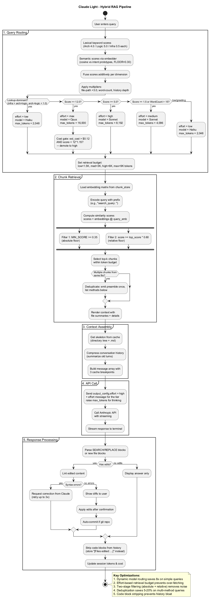

# RAG Pipeline

> Part of the [architecture index](ARCHITECTURE.md). Source: the original `docs/architecture.md`, split by topic.

The Retrieval-Augmented Generation pipeline finds and injects only relevant code into the context.

### Key Optimizations

1. **Hybrid Query Routing** - Keyword signals fused with embedding-based semantic scores against intent prototypes; cost-aware tier gating prevents over-spending on simple queries
2. **Effort-Based Budget** - Low effort = 1.5K tokens, Max effort = 9K tokens
3. **Two-Stage Filtering** - Absolute floor (0.35) + Relative floor (60% of top score)
4. **Deduplication** - Shared preamble emitted once for multi-method results
4a. **Test-file exclusion** - In the hybrid path, chunks under a test directory are never selected for a question that does not mention tests (`_exclude_test_chunks` in `retrieval.py`). Measured in docs/BENCHMARKS.md.
5. **Code Block Stripping** - Edit blocks removed from history to prevent bloat
6. **LLMLingua-2 Compression** *(on by default, no-op if `llmlingua` not installed)* - Post-retrieval token pruning of the retrieved-context block (see below)

### Effort Levels

| Effort | Model | Router Max Tokens | Sent Max Tokens | Retrieval Budget |
|--------|-------|-------------------|-----------------|------------------|
| low | Haiku 5.5 | 2,048 | 8,000 | 1,500 |
| medium | Sonnet 5.5 | 4,096 | 16,000 | 3,000 |
| high | Sonnet 5.5 | 8,192 | 32,000 | 6,000 |
| max | Opus 5.5 | 16,000 | 64,000 | 9,000 |

The 5.5 models always think adaptively. The tier's effort is sent as `output_config.effort` (a thinking budget is rejected with a 400), and because thinking tokens count against `max_tokens`, `_apply_effort()` raises the cap to the "Sent" column. The router's own figure is still what the cost gate below estimates with. In OAuth mode only the model is passed to the CLI.

