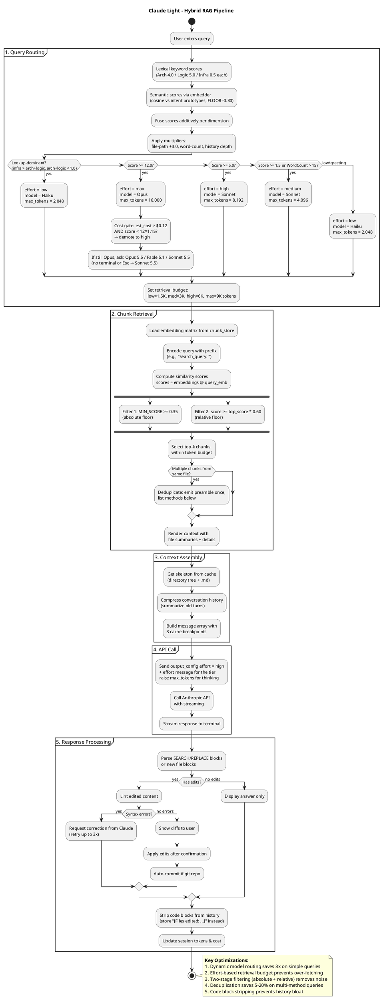

# Hybrid Router

> Part of the [architecture index](ARCHITECTURE.md). Source: the original `docs/architecture.md`, split by topic.


`route_query()` (`llm.py`) classifies every query into one of the four effort tiers using a two-signal hybrid:

**1. Lexical signals** — substring matching over three module-level `frozenset`s:

| Dimension | Weight per match | Examples |
|-----------|-----------------|---------|
| Arch | 4.0 | `evaluate`, `architecture`, `scalability`, `trade-off`, `deeply` |
| Logic | 5.0 | `implement`, `refactor`, `fix`, `debug`, `create` |
| Infra | 0.5 | `list`, `where`, `find`, `show`, `count` |

**2. Semantic signals** — if the `SentenceTransformer` embedder is loaded, the query is encoded once and compared (cosine dot product, already L2-normalised) against 9 precomputed prototype phrases — 3 per dimension. The closest prototype per dimension contributes up to `ROUTER_SEMANTIC_WEIGHT = 6.0` points, scaled linearly above `ROUTER_SEMANTIC_FLOOR = 0.30`. Prototype embeddings are built lazily in a single batched encode call and cached for the lifetime of the loaded model (`_PROTO_CACHE`). **When the embedder is absent** (test mode, pre-index), all semantic scores are 0 and the fused score equals the pure keyword score exactly.

**Fusion** — lexical and semantic dimension scores are added directly (same units):

```
arch  = lex_arch  + sem_arch
logic = lex_logic + sem_logic
infra = lex_infra + sem_infra
score = arch + logic + infra
```

**Contextual multipliers** (applied after fusion):
- File-path mention detected by regex → `+3.0`
- Word-count complexity bonus (`+1.5` / `+2.0` / `+5.0` for >4 / >10 / >30 words), gated: only applies when `arch + logic > 0` (a long lookup query does not get promoted by verbosity alone)
- Conversation depth → `+0.5 × (turns // 2)`

**Tier selection** — raw thresholds as before: `≥12 → max`, `≥5 → high`, `≥1.5 or wc>15 → medium`, else `low`.

**Cost-aware adjustments** (applied after tier selection):

1. *Lookup downgrade*: if `infra > (arch + logic)` and `(arch + logic) < 1.0`, the query is lookup-dominant and forced to `low/Haiku/2048` regardless of score or word count.
2. *Escalation gate*: for any tier whose estimated cost exceeds `ROUTER_COST_CEILING = $0.12`, the router requires `score ≥ tier_threshold × (1 + ROUTER_ESCALATE_MARGIN)` (default margin 0.15). At the defaults this gate only fires for the `max/Opus` tier (~$0.20 per query); `high` (~$0.06) and below are never demoted by cost. A clearly architectural query (score ≫ 13.8) clears the bar and keeps Opus; a borderline one is demoted to `high`.

Cost is estimated at the tier model's rates: `(retrieval_budget + 1500) / 1M × input + max_tokens × 0.5 / 1M × output`.

**`/why` output** includes a `Routing:` line showing per-dimension scores, whether semantic scoring was active, and the estimated cost.

**How the tier reaches the API** (`_apply_effort()`, API-key mode). Every request sends the same top-level `output_config.effort`, `BASE_EFFORT = "high"`. When the tier's effort differs, an effort-only system message, `{"role": "system", "content": [], "output_config": {"effort": <tier>}}`, goes right before the question, under the beta `mid-conversation-output-config-2026-07-01`. A top-level effort change between requests would invalidate the cached history, and on some models the cached skeleton too. The effort message sits after the history's cache breakpoint and is not stored in `conversation_history`, so the next turn's prefix still matches. The base is `high` because lowering effort this way is reliable. The OAuth path flattens messages into prompt text, so it gets no effort message.

**The model is routed once per session by default** (next paragraph). The cache is scoped per model, so a switch writes the target model's cache. Pinning a session to its strongest model so far was simulated with `tests/benchmarks/benchmark_session_cache.py` and rejected: 33 of the 43 repo questions route to Haiku, whose output costs a twentieth of Sonnet's, and a session pinned to Sonnet cost 48% to 67% more. Each model's cached history prefix also stays readable for 5 minutes across switches, so switching back pays only for the turns in between. See `TOKEN-SAVINGS.md`, lever 1.

**Route the model once (`ROUTE_ONCE`, on by default; `CLAUDE_LIGHT_ROUTE_ONCE=0` routes it per turn).** `_finalize_route()` stores the first turn's model in `state.session_model` and uses it for every later turn; the effort, `max_tokens` and retrieval budget are still routed per turn, and the `/budget` cap still drops a turn to Haiku. `/clear` resets it, so the next question routes the model again. Once it is set, `warm_cache()` (skeleton changes and the heartbeat) warms it instead of `MODEL`; the warm at startup still uses `MODEL`, since no question has been routed yet. In the benchmark a session opening on Sonnet cost 71% more than per-turn routing, and one opening on Haiku cost 91% less by answering every later question on Haiku. A greeting as the first message therefore pins Haiku for the session, until a question routes to the top tier (next paragraph). It is the default by the developer's choice, against the cost model's mixed result; answer quality is not scored (#90).

**The top tier asks first.** `route_query()` only scores the question; `_finalize_route()`, called by `chat()` and one-shot, applies the session. When a question routes to Opus, it asks: Opus 5.5, Fable 5.1, Sonnet 5.5, or Sonnet 5.5 without asking again this session. Each option shows its estimated cost for the turn. Esc picks Sonnet, and so does a run without a terminal (piped input), which prints one line saying so. Fable 5.1 is never routed to directly: it costs 2.5 times Opus 5.5 ($10 / $50 per MTok) and no repo question reaches even the Opus tier, so there is no data to place a threshold. Under `ROUTE_ONCE` the answer becomes the session model; this is the only route that can move a session to another model, and a session already on Opus or Fable is not asked again. The `/budget` cap is checked first: over it, the turn runs on Haiku without asking. Benchmarks and `/why` call `route_query()` directly, so they never pin or prompt.

<details>
<summary>View PlantUML Source</summary>



</details>

